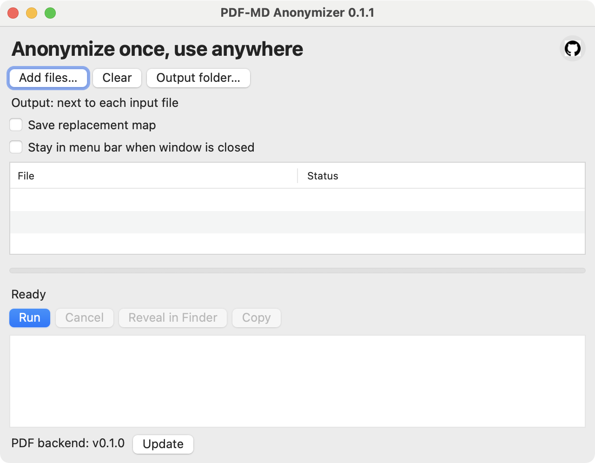

# pdf-md-anonymizer

CLI tool that anonymizes PDF and Markdown documents: private data — PII, full
names, legal entities, keys, secrets — is replaced with reversible `{{TOKEN}}`
placeholders, and a separate map file lets the originals be restored.

Works fully offline. PDF input is converted by reusing the external
[`pdf2md`](https://github.com/zanybaka/pdf-to-markdown) tool; everything else
operates on Markdown text.

## Install

```bash
uv tool install git+https://github.com/zanybaka/pdf-md-anonymizer
```

PDF input needs a `pdf2md` converter. The opt-in `[pdf]` extra bundles one into
the tool's own environment (the docling backend pulls heavier ML dependencies,
so it stays opt-in):

```bash
uv tool install "pdf-md-anonymizer[pdf] @ git+https://github.com/zanybaka/pdf-md-anonymizer"
```

Without `[pdf]`, PDF input still works if a `pdf2md` is on `PATH`. The desktop
`.app` ships lean and installs the PDF backend on first PDF use — a one-time,
network-dependent step (see ADR-0008); everything else runs fully offline.

## Usage

```bash
# Anonymize a file — writes doc.anon.md and doc.anon.map.json next to it
anon doc.md
anon doc.pdf            # PDF is converted via pdf2md first

# Explicit output paths
anon doc.md -o out.md --map out.map.json

# From stdin (writes to stdout)
cat doc.md | anon -

# Restore the original text
anon restore doc.anon.md --map doc.anon.map.json -o original.md
```

Tokens look like `{{PERSON_1}}`, `{{EMAIL_2}}`, `{{INN_1}}`. The same source
value always maps to the same token within one run.

## How it works

The detection pipeline runs these stages in order:

1. **Input** — a PDF is converted to Markdown via the external `pdf2md`
   subprocess; a Markdown file is read directly.
2. **Conversion cleanup** — hyphenated line-breaks are rejoined and
   space-padded hyphens normalized (PDF input only).
3. **Regex detection** — structured identifiers (email, phone, INN, cards,
   addresses, secrets, …); highest precision, wins overlaps.
4. **NER detection** — Natasha tags names, organizations, and locations:
   case-normalize, tag, trim spans, POS filter, skill-section suppression,
   stoplists, hyphen merge; kept only where it does not overlap a regex span.
5. **Consistency sweep** — each detected value is propagated to its other
   occurrences in the text.
6. **Overlap resolution** — overlapping spans are reduced (earlier match wins).
7. **Replacement** — spans are replaced right-to-left with `{{TOKEN}}`
   placeholders and a JSON replacement map is written; `restore` reverses it.

## Desktop app

A Toga desktop UI (`anonymizer_ui`) wraps the same core in-process — pick one or
many files, set options, run, and watch live per-file progress.



Build a macOS `.app` / `.dmg`:

```bash
bash scripts/build_app.sh   # ~/.briefcase-out/.../PDF-MD Anonymizer.app
bash scripts/build_dmg.sh   # dist/PDF-MD Anonymizer-<version>.dmg
bash scripts/run_app.sh     # launch the built .app
```

Release procedure is in [DEPLOYMENT.md](DEPLOYMENT.md).

## Notes

- Requires Python 3.11+.
